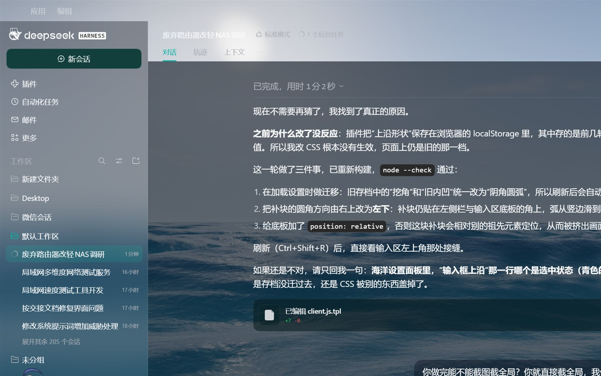

# dsh-ocean-bg

把 [DeepSeek Harness](https://github.com/deepseek-ai)（下称 DSH）的聊天窗口换成**实时 WebGL 海洋**，并把整个界面改成**青绿玻璃**风格的一个 DSH 客户端皮肤插件。

> **这是一份半成品。** 界面能跑，功能都在，但有两块没做完：一是代码没有测试、没有 CI、没做兼容性回归；二是"耳脚"（输入区左上角那种把两个面接起来的阴角圆弧）我试了七八种写法都没做对，最后放弃了那条路，只留了普通圆角。希望有人接手把它做干净。

一句话交代来源：**代码大部分由 AI 辅助生成**，设计与取舍是人定的。原创设计、原创调参；没有抄任何现成皮肤，也没有引用别人的渲染器——这片海是自己写的一千多行 WebGL，不是 three.js。



## 它做了什么

### 1. 实时海洋背景（`assets/ocean.html`）

一整页的 WebGL 海洋，铺在界面底下当背景，透明玻璃叠在它上面。

- 单文件、零依赖、零外部资源：一个 `<canvas>` 加约 1500 行原生 WebGL，不加载任何图片、视频或第三方库。
- 海面是顶点位移的网格，片元着色器里自己算 5 阶噪声波形、日光高光、菲涅尔反射和泡沫带。
- 天空是单独一遍全屏 pass，颜色随时间变化（正午 / 黄昏 / 极夜三套预置）。
- 通过 `<iframe>` 挂在 DSH 页面里，隔离样式与 WebGL 上下文；父页面用 `postMessage` 控制它。

### 2. 整站青绿玻璃

DSH 的界面是靠一组 `--dsw-*` CSS 变量（design token）驱动的。插件不去改 DSH 的源码，只在 `html.dsh-obg` 下**覆盖这些 token**，把：

- 按钮、下拉、菜单、弹层、卡片、设置面板、代码块
- 侧栏、对话区、输入区

全部改成半透明的青绿玻璃（`rgba(...)` + `backdrop-filter: blur()`），浅色主题和深色主题各一套。

### 3. 输入区：一整块玻璃

输入区不是一张"浮在海上的卡片"，而是从输入框上沿起一路铺到窗口底边的一整块玻璃，上沿可以选圆角或直角。对话内容滚到它上面会自然淡出（用 `mask-image`，不是盖一条黑色渐变）。

### 4. 控制面板

右下角"海洋设置"（或 `Ctrl+Shift+O`）打开：

| 分组 | 设置项 |
| --- | --- |
| 全局遮罩 | 无 / 黑 / 白 / 主题绿 + 浓度（压在海之上、界面之下的一整层） |
| 侧栏毛玻璃 | 模糊、浓度 |
| 输入框毛玻璃 | 与侧栏一致（默认）/ 单独设置；模糊、浓度 |
| 输入框上沿 | 圆角 / 直角；圆角半径 |
| 时刻 | 正午 / 黄昏 / 极夜 |
| 海浪 | 浪高、尺度、碎浪、波速 |
| 播放 | 暂停 / 继续、环绕开关 |

所有设置写在 `localStorage`，下次打开还在。

## 怎么用

### 作为 DSH bundle 安装（推荐）

```bash
git clone https://github.com/1hhr10/dsh-ocean-bg.git
cd dsh-ocean-bg
npm run build          # 由 lib/client.js.tpl + assets/ocean.html 生成 lib/client.js
```

然后在 DSH 的 profile 里把它加进 `dsh.profile.bundles`：

```jsonc
// ~/.dsh/profiles/<你的 profile>/package.json
{
  "dependencies": {
    "dsh-ocean-bg": "link:/绝对路径/dsh-ocean-bg"
  },
  "dsh": {
    "profile": {
      "bundles": ["...", "dsh-ocean-bg"]
    }
  }
}
```

改完重启 DSH。之后改样式只要 `npm run build` 再刷新页面（`Ctrl+Shift+R`）。

### 直接改代码

- `lib/client.js.tpl` —— 全部界面逻辑与 CSS 模板，**要改就改这个**。
- `assets/ocean.html` —— 海洋渲染，独立可跑，浏览器直接打开也能看。
- `lib/build.mjs` —— 把 `client.js.tpl` 里的 `__OCEAN_HTML__` 换成 `assets/ocean.html` 的内容，输出 `lib/client.js`。产物是给浏览器加载的，不要手改。
- 改完务必 `node --check lib/client.js`（把文件复制成 `.mjs` 再 check 也行），我在这上面栽过：一个多余的右花括号让整个插件不加载，界面上表现为"设置面板消失了"。

## 已知问题（如实列出）

1. **"耳脚"没做出来。** 输入区左上角，侧栏竖边和输入区横边相接的那个阴角，想要一段从竖边滑到横边的内凹圆弧（术语大概是 inverted radius / concave corner / cove fillet）。我试过补块 + `border-top-right-radius`、`mask-image` 挖圆、`clip-path` 贝塞尔，都没做出想要的那个形状，最后把这几个档位全删了，只留圆角和直角。代码里还留着 `cornerPath()` 这类没被调用的函数，谁想做可以接着来。
2. **没有测试。** 没有单测、没有 Playwright 验收、没有 CI。现在的正确性靠"改完刷新看一眼"。
3. **只在一台机器上验证过。** Windows 11 + DSH 0.2.2-rc.5 + Electron 44 / Chrome 152。macOS、Linux、其他 DSH 版本没试过。
4. **DSH 内部类名是硬编码的。** 选择器里有 `.an3WzG_scrollBody`、`.mP3x-q_frame`、`.AnXs9G_panel` 这种带哈希的类名，DSH 一升级就可能全部失效。这是最脆的一处。
5. **注释里有零星「。」占位。** 有一次编码事故（UTF-8 被当 GBK 读回）丢了几个字节，跑通后我把坏字符换成了句号，代码和界面文字都复原了，只有注释里还留着。
6. **性能只做到"不卡"，没做到"很省"。** 界面空闲时仍占约 1.5 个核（海洋画布 + 三层全屏毛玻璃都在给动态画面做模糊）。我已经把几处明显的问题修了（见下），但没有系统性地优化。

### 已经修过的性能坑（留个记录）

- `softPass()` 原来每 2 秒无条件遍历子树，节点上万时一次几百毫秒 → 改成先比对布局签名，变了才做。
- `clearTopGlobal()` 原来 `document.body.querySelectorAll('div, header, section, nav, aside')`，一万个节点一次 75–440ms → 改成只扫 body 往下三层 + 按类名找，2–5ms。
- 删掉了 `*:has([data-composer-card])` 这种全文档 `:has` 选择器。
- 删掉了 `-webkit-backdrop-filter` 的重复声明，以及设置遮罩自带的第二层 blur。
- 海洋里原来有一套"帧率低了就自动降分辨率"的循环，每 2.6 秒重建一次画布，表现为隔一阵卡一下 → 停用，宁可不降画质。

## 想要但没做的

- 把上面那几个内部类名换成更稳的锚点（`data-*`、`role`、结构关系），让它扛得住 DSH 升级。
- 耳脚那张图。
- 深夜/清晨的更多时刻预置，以及按系统时间自动切换。
- 把海洋渲染从 iframe 换成 Web Worker + OffscreenCanvas 的可能性评估。
- 单测与截图对比测试。
- 一个真正意义上的"主题包"格式，而不是覆盖 token 的 CSS。

## 开发

```bash
npm run build      # 生成 lib/client.js
```

海洋本身可以直接看：用浏览器打开 `assets/ocean.html`，它自带 UI，能调浪高、日光、时刻。

## 许可

MIT，见 [LICENSE](LICENSE)。

## 最后

这份东西是在一个晚上被反复推倒重做出来的，能跑，但不干净。如果你是 DSH 插件作者、或者只是看不惯这段代码，欢迎直接开 issue 或 PR——尤其是"耳脚"那条，我确实没整明白。
